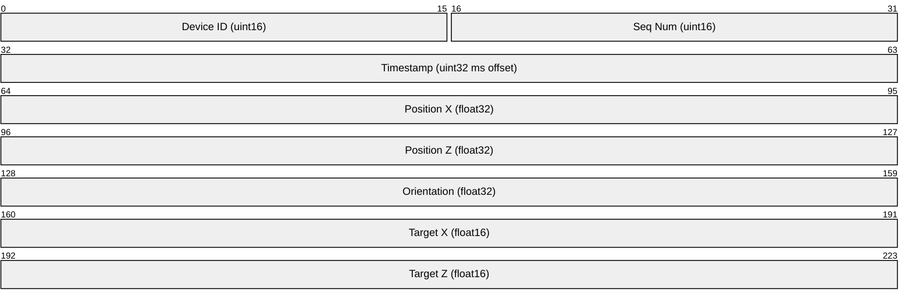
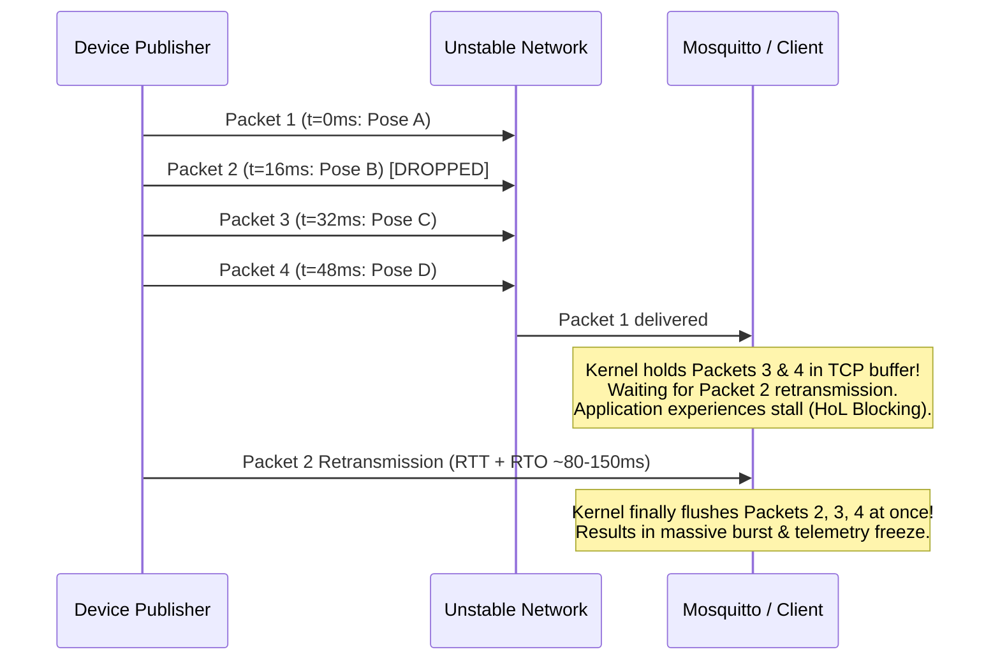
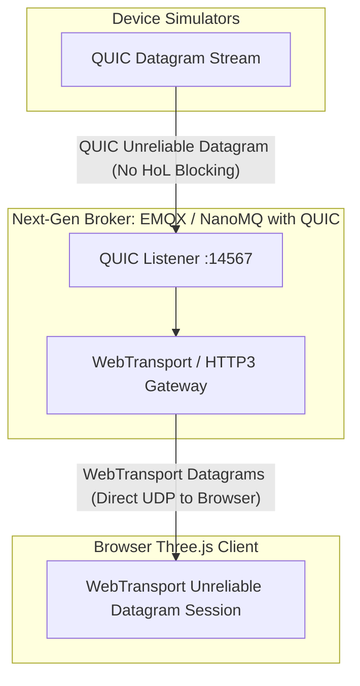
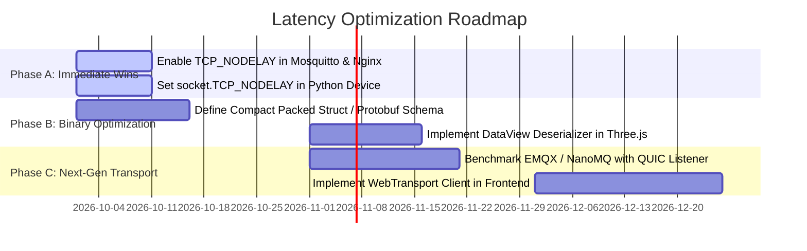

# ⚡ Telemetry Latency & Synchronization: Kinematic Trade-Offs & Transport Optimization

This document provides a comprehensive technical breakdown of **kinematic synchronization trade-offs** (direct write, per-entity interpolation, global interpolation, extrapolation) and details **concrete future transport optimizations** (binary serialization, dropping TCP Head-of-Line blocking via QUIC/UDP, and disabling Nagle's algorithm via `TCP_NODELAY`) to minimize end-to-end latency in the distributed 3D digital twin pipeline.

---

## 🏗️ 1. Pipeline Latency Anatomy

In a distributed 3D telemetry architecture (Autonomous Device $\to$ Mosquitto Broker $\to$ WebSocket/WebTransport $\to$ Three.js / NVIDIA Omniverse), total observed visual latency $\tau_{\text{total}}$ consists of two distinct components:

$$\tau_{\text{total}} = \tau_{\text{transport}} + \tau_{\text{playback}}$$

```mermaid
flowchart LR
    subgraph Edge_Device [IoT / Simulator]
        Phys[Physics Tick] --> Serial[Serialization: JSON / Binary]
        Serial --> KernelOut[Kernel Socket Buffer: Nagle?]
    end

    subgraph Transport_Layer [Network & Broker]
        KernelOut -->|"Wire Transit (TCP / QUIC)"| Broker[Mosquitto Core]
        Broker -->|"Multiplex Push (TCP / WS / WebTransport)"| KernelIn[Client Ingress]
    end

    subgraph Client_Playback [Three.js / Omniverse]
        KernelIn --> Deserial[Deserialization]
        Deserial --> Queue[Jitter / History Buffer: \tau_playback]
        Queue --> Interp[Direct / LERP / Spline / Extrapolate]
        Interp --> GPU[60/144 FPS Render]
    end
```



1. **Transport Latency ($\tau_{\text{transport}}$)**:
   - Time required to serialize, transmit across the network stack, route through the MQTT broker, and deliver to the client socket.
   - Dominated by payload size, serialization overhead, TCP queuing (Nagle's algorithm), and network packet loss (TCP Head-of-Line retransmission).
2. **Playback Buffer Latency ($\tau_{\text{playback}}$)**:
   - Artificial delay intentionally introduced on the client side to absorb jitter and allow smooth curve interpolation ($C^0$ / $C^1$ continuity).
   - Dominated by the chosen kinematic algorithm and update frequencies.

---

## ⚖️ 2. Kinematic Synchronization Trade-Offs

Each rendering mode makes an explicit compromise between **visual smoothness**, **temporal ground truth (latency)**, **multi-entity spatial consistency**, and **computational overhead**.

```mermaid
quadrantChart
    title Kinematics Trade-off: Latency vs. Visual Smoothness
    x-axis Low Visual Smoothness (Stepping/Jitter) --> High Visual Smoothness (Fluid Curves)
    y-axis High Latency (Historical Delay) --> Low Latency (Real-time Ground Truth)
    quadrant-1 Ideal (Extrapolation with low noise)
    quadrant-2 Low-Lag Raw (Direct Write)
    quadrant-3 Stuttering/Discontinuous
    quadrant-4 Fluid but Delayed (Spline Interpolation)
    "Direct Write (v1)": [0.15, 0.95]
    "Extrapolation (v4)": [0.72, 0.88]
    "Per-Entity Spline (v5)": [0.92, 0.35]
    "Global Interpolate": [0.96, 0.15]
    "Simple LERP (v2)": [0.45, 0.65]
```

---

### 2.1 Mode 1: Direct Write (Plain Data / Raw Snap Without Processing)

*Implemented as: `v1_raw_snap` in `frontend/src/interpolation.js`*

#### Mechanism
Upon packet receipt at time $t_{\text{recv}}$, the 3D entity's transform is instantaneously replaced with the incoming packet coordinates:
$$\vec{P}_{\text{render}}(t) = \vec{P}_{\text{latest}}, \quad \theta_{\text{render}}(t) = \theta_{\text{latest}}$$

#### Latency Profile
- **Artificial Playback Latency**: $\tau_{\text{playback}} = 0\text{ ms}$.
- Total delay is strictly equal to the raw transport latency: $\tau_{\text{total}} = \tau_{\text{transport}}$.

#### Trade-Off Analysis
| Advantages | Disadvantages & Failure Modes |
| :--- | :--- |
| **Ground Truth Accuracy**: The visualizer reflects the freshest known coordinates without artificial dampening or temporal offset. | **Severe Temporal Aliasing & Stepping**: If telemetry frequency ($f_{\text{pub}} = 1\text{–}24\text{ Hz}$) is lower than screen refresh ($f_{\text{render}} = 60\text{–}144\text{ Hz}$), the entity remains static for multiple frames, then teleports abruptly. |
| **Zero Memory / CPU Cost**: $O(1)$ memory assignment; no spline evaluation, no keyframe buffer queues, zero GC churn. | **Orientation Snapping**: Yaw angles snap discontinuously, inducing disorienting camera jitter when tracking entities. |
| **Ideal for Teleoperation**: Operators receive immediate feedback without lagging behind robot collision boundaries. | **Sensitive to Ingress Jitter**: Network timing micro-bursts translate directly into visual judder. |

---

### 2.2 Mode 2: Per-Entity Interpolation (Smooth Action, Artificial Latency)

*Implemented as: `v3_hermite_spline` and `v5_catmull_rom` in `frontend/src/interpolation.js`*

#### Mechanism
Incoming keyframes are retained in a per-entity ring buffer. The entity is rendered at a delayed playback point:
$$t_{\text{render}}(i) = t_{\text{client}} - \tau_{\text{playback}}(i)$$
where $\tau_{\text{playback}}(i) \ge k \times \Delta t_{\text{packet}}(i)$ ($k = 1$ for Hermite Splines, $k = 2$ for Centripetal Catmull-Rom). The position is evaluated via parametric curves:
$$\vec{P}(u) = \sum_{j=0}^{3} B_j(u) \vec{P}_j, \quad u \in [0, 1]$$

#### Latency Profile
- **Artificial Playback Latency**: $\tau_{\text{playback}} = k \times \frac{1000}{f_{\text{pub}}} + \delta_{\text{margin}}$.
  - At $60\text{ Hz}$: $\tau_{\text{playback}} \approx 33\text{–}45\text{ ms}$.
  - At $24\text{ Hz}$: $\tau_{\text{playback}} \approx 85\text{–}110\text{ ms}$.
  - At $1\text{ Hz}$: $\tau_{\text{playback}} \approx 2030\text{ ms}$ (2 full seconds of intentional delay).

#### Trade-Off Analysis
| Advantages | Disadvantages & Failure Modes |
| :--- | :--- |
| **$C^1$ Tangent & Curvature Continuity**: Completely eliminates teleportation, producing fluid, cinematic vehicle paths. | **Perception Lag**: Observers view a delayed historical state. In fast teleoperation, obstacles may be hit before the visualizer shows the collision. |
| **Per-Device Optimality**: High-rate devices ($60\text{ Hz}$) enjoy minimal latency ($~35\text{ ms}$) without being penalized by slow devices. | **Multi-Entity Temporal Desynchronization**: If Device A publishes at $60\text{ Hz}$ ($\tau_A \approx 35\text{ ms}$) and Device B publishes at $1\text{ Hz}$ ($\tau_B \approx 2000\text{ ms}$), their rendered positions correspond to **different historical moments**! Physical proximity, lane crossings, and collision checks between them are visually distorted. |
| **Jitter Absorption**: Variations in network arrival times are absorbed by the buffer horizon without visual hitching. | **Buffer Starvation Halts**: If packet delivery stalls beyond the buffer horizon, the spline engine freezes at the last knot. |

---

### 2.3 Mode 3: Global Interpolation (Unified Fleet Synchronization, Shared Artificial Latency)

#### Mechanism
Instead of per-entity dynamic delay offsets, the entire 3D client adopts a single authoritative historical timeline:
$$t_{\text{global\_render}} = t_{\text{client}} - \tau_{\text{global}}$$
where the global latency $\tau_{\text{global}}$ is clamped to the slowest entity or the worst-case jitter horizon in the fleet:
$$\tau_{\text{global}} \ge \max_{i \in \text{Fleet}} \left( k \times \Delta t_i + \text{jitter}_i \right)$$

#### Latency Profile
- **Artificial Playback Latency**: $\tau_{\text{global}} = \max_i(\tau_i)$.
  - If 9 devices publish at $60\text{ Hz}$ ($16\text{ ms}$) and 1 device publishes at $1\text{ Hz}$ ($1000\text{ ms}$), **all 10 devices are delayed by $>2000\text{ ms}$**.

#### Trade-Off Analysis
| Advantages | Disadvantages & Failure Modes |
| :--- | :--- |
| **Absolute Multi-Entity Spatial Coherence**: Every entity in the scene corresponds to the identical timestamp $t_{\text{global\_render}}$. Formations, swarms, relative distances, and collision warnings are geometrically and physically valid. | **Least Common Denominator Penalty**: A single slow, degraded, or intermittent worker (e.g. edge device on cellular) penalizes the entire visualizer with high latency. |
| **Eliminates Inter-Entity "Temporal Paradoxes"**: Prevents high-frequency walkers from appearing "in the future" relative to low-frequency walkers. | **High Memory Buffer Footprint**: High-rate publishers ($60\text{ Hz}$) must buffer $120+$ historical keyframes to bridge a 2-second global delay horizon. |
| **Deterministic Replay & Analysis**: Simplifies synchronization with external video feeds or sensor logs. | **Global Cascade on Packet Loss**: If the slowest entity suffers an outage, the global playback clock must either stall for everyone or drop the dead entity into an unlinked degraded mode. |

---

### 2.4 Mode 4: Extrapolation (Predictive Dead-Reckoning, Jitter & Overshoot)

*Implemented as: `v4_continuous_seamless` in `frontend/src/interpolation.js`*

#### Mechanism
Predicts the entity's position forward in time along its estimated linear and angular velocity vectors:
$$\vec{P}_{\text{extrap}}(t + \Delta t) = \vec{P}_{\text{current}} + \vec{v}_{\text{est}} \Delta t + \frac{1}{2} \vec{a}_{\text{est}} \Delta t^2$$
When a new ground-truth packet arrives with discrepancy $\vec{e} = \vec{P}_{\text{truth}} - \vec{P}_{\text{extrap}}$, an exponential reconciliation blend is applied:
$$\vec{P}(t + \Delta t) = \vec{P}_{\text{extrap}} + \vec{e} \cdot (1 - e^{-\gamma \Delta t})$$

#### Latency Profile
- **Artificial Playback Latency**: $\tau_{\text{playback}} \le 0\text{ ms}$.
- Can achieve **zero perceived latency** or even negative latency (compensating for network transit lag).

#### Trade-Off Analysis
| Advantages | Disadvantages & Failure Modes |
| :--- | :--- |
| **Zero Delay / Instant Response**: Objects react immediately to incoming updates without waiting for future keyframe buffers. | **Path Overshoot on Turns & Stops**: When an entity turns 90° or stops abruptly, the extrapolator projects it along its previous trajectory, causing it to "blow past" the corner. |
| **Seamless Bridging Across Packet Drops**: If a packet is lost, the entity continues moving naturally instead of freezing. | **Rubber-Banding & Snapping Jitter**: When the delayed ground-truth packet arrives, correcting the prediction error introduces visual twitching, snapping, or high-frequency vibration. |
| **Natural for Ballistic / Straight-Line Motion**: Exceptionally smooth for steady-state highway driving or constant-speed linear trajectories. | **Noise Amplification**: Differentiating position to compute velocity $\vec{v} = \frac{\Delta \vec{p}}{\Delta t}$ magnifies timestamp jitter and sensor noise. |

---

### 2.5 Kinematic Trade-Off Matrix

| Metric / Dimension | 1. Direct Write (`v1`) | 2. Per-Entity Interp (`v3`/`v5`) | 3. Global Interp | 4. Extrapolation (`v4`) |
| :--- | :---: | :---: | :---: | :---: |
| **Artificial Delay ($\tau_{\text{playback}}$)** | **$0\text{ ms}$** | $30\text{–}2000\text{ ms}$ (per entity) | $\max(\tau_i) \approx 2000\text{ ms}$ | **$\le 0\text{ ms}$** |
| **Visual Smoothness (60 FPS)** | Poor (Stepping) | **Exceptional ($C^1$ Spline)** | **Exceptional ($C^1$ Spline)** | Moderate to High |
| **Multi-Entity Time Sync** | Desynced (Arrival Time) | Desynced (Rate Dependent) | **100% Synchronous** | Desynced (Prediction Drift) |
| **Overshoot / Snapping Risk** | None (Immediate) | None (Pure Interpolation) | None (Pure Interpolation) | **High (Rubber-banding)** |
| **Tolerance to Network Jitter** | Poor | **High (Buffer Horizon)** | **High (Buffer Horizon)** | High (Dead-reckoning) |
| **Memory / CPU Overhead** | Minimum $O(1)$ | Low ($O(N)$ 4-frame queue) | Moderate ($O(N \cdot M)$ queue) | Low ($O(1)$ velocity state) |
| **Recommended Application** | Teleoperation / Debugging | Independent Autonomous Agents | Swarm / Collision Analysis | Linear Driving / Gaming |

---

## 🚀 3. Proposed Fixes to Reduce Transport Latency

While kinematic tuning optimizes $\tau_{\text{playback}}$, network layer optimizations eliminate bottlenecks in $\tau_{\text{transport}}$.

---

### 3.1 Optimization 1: Compact Binary Payload Serialization

#### Problem Statement
Currently, telemetry packets are serialized as verbose UTF-8 JSON strings via `json.dumps()` in Python and parsed with `JSON.parse()` in JavaScript/Three.js:

```json
{
  "device_id": "dev-4821",
  "device_name": "Device dev-4821",
  "model_type": "target_waypoints",
  "color": "#38bdf8",
  "x": 4.123,
  "z": -8.456,
  "orientation": 1.5708,
  "target_x": 10.0,
  "target_z": 5.0,
  "write_hz": 24.0,
  "timestamp": 1727061897.123456
}
```
- **Payload Size**: ~220–260 bytes per packet.
- **Bandwidth Footprint**: At 50 devices $\times$ 60 Hz $\approx 3,000\text{ msg/sec} \approx 780\text{ KB/sec}$ of continuous string parsing.
- **CPU & Garbage Collection**: High object allocation rates in V8 trigger periodic minor garbage collection pauses, causing 5–15ms frame drops.

#### Proposed Solution: Packed Binary Struct / Protocol Buffers
State updates can be packed into a fixed 24-byte binary frame containing IEEE 754 float32 values and a monotonic sequence integer:



#### Code Implementation Blueprint

**Python Publisher (`device/main.py`)**:
```python
import struct

# Format: < (little-endian), H (uint16 id), I (uint32 seq), d (float64 time), fff (x, z, yaw)
TELEMETRY_STRUCT = struct.Struct("<HIdfff")

def pack_telemetry(numeric_id: int, seq: int, t: float, x: float, z: float, yaw: float) -> bytes:
    return TELEMETRY_STRUCT.pack(numeric_id, seq, t, x, z, yaw) # Exactly 30 bytes
```

**JavaScript / Three.js Receiver (`frontend/src/main.js`)**:
```javascript
// Zero-copy deserialization using ArrayBuffer & DataView
client.on('message', (topic, payloadBuffer) => {
  const view = new DataView(payloadBuffer.buffer, payloadBuffer.byteOffset, payloadBuffer.byteLength);
  const deviceId = view.getUint16(0, true);
  const seq = view.getUint32(2, true);
  const timestamp = view.getFloat64(6, true);
  const x = view.getFloat32(14, true);
  const z = view.getFloat32(18, true);
  const yaw = view.getFloat32(22, true);

  updateDevicePose(deviceId, x, z, yaw, timestamp);
});
```

#### Latency & Throughput Impact
- **Wire Size Reduction**: $240\text{ bytes} \to 24\text{ bytes}$ (**90% payload shrink**).
- **Deserialization Speed**: Zero-copy `DataView` or TypedArray view is **15–30x faster** than `JSON.parse()`.
- **Eliminates GC Spikes**: Avoids allocating temporary JSON dictionary objects on every animation tick.

---

### 3.2 Optimization 2: Drop TCP Head-of-Line Blocking (MQTT over QUIC / UDP / WebTransport)

#### Problem Statement: The TCP Head-of-Line (HoL) Bottleneck
Standard MQTT uses TCP (port `1883`) or WebSocket over TCP (port `9001`). TCP enforces **strict in-order delivery** at the kernel transport layer:



In real-time telemetry, **stale data is worthless data**. If Packet 2 (pose at $t=16\text{ms}$) is dropped, the application does *not* want the network stack to block Packet 4 (pose at $t=48\text{ms}$). Delaying fresh packets to retransmit old coordinates causes artificial telemetry lag spikes of **80ms to 500ms** on lossy connections (e.g. WiFi / 5G).

#### Proposed Architecture: MQTT over QUIC / WebTransport



1. **Independent Multiplexed Streams & Datagrams**:
   - QUIC (RFC 9000) runs over UDP. Packet loss on one entity's stream does **not** stall packets on another stream.
   - For real-time telemetry, QUIC Datagrams (RFC 9221) allow **unreliable, unordered delivery**: dropped keyframes are simply discarded, allowing the newest frame to be delivered with zero retransmission delay.
2. **0-RTT Reconnection**:
   - TLS 1.3 handshake is integrated into the QUIC initial connection, enabling sub-millisecond reconnects without TCP multi-way handshakes.
3. **Browser Ingress via WebTransport**:
   - Modern browsers support `WebTransport` (`new WebTransport('https://broker.example:4433/mqtt')`), which provides direct client-side UDP datagram access, replacing TCP WebSockets.

---

### 3.3 Optimization 3: Disable Nagle’s Algorithm (`TCP_NODELAY`)

#### Problem Statement: The Nagle + Delayed ACK Trap
By default, operating system TCP sockets enable **Nagle's algorithm** (RFC 896). Nagle's algorithm was designed to prevent network congestion by coalescing small outgoing packets ($< \text{MSS} \approx 1460\text{ bytes}$) until:
1. The pending buffer fills up to MSS, **or**
2. An acknowledgment (ACK) is received for the previously transmitted segment.

Simultaneously, receiving TCP stacks (Linux kernel, Windows, macOS) enable **Delayed ACK**, which delays sending an ACK packet for up to **40ms to 200ms** in hopes of piggybacking it onto returning data:

$$\text{Nagle waits for ACK} \quad \times \quad \text{Receiver delays ACK} \quad = \quad \mathbf{40\text{–}200\text{ ms Artificial Latency Bubble}}$$

Because telemetry packets are small (~200 bytes) and published periodically at discrete intervals (e.g. every 16ms or 41ms), Nagle's algorithm frequently buffers the telemetry message in kernel memory instead of dispatching it immediately to the physical wire.

#### Implementation: Enforcing `TCP_NODELAY` Across All Layers

#### 1. Mosquitto Broker Configuration (`mosquitto.conf`)
Ensure `set_tcp_nodelay` is explicitly enabled:
```conf
# mosquitto.conf
listener 1883
allow_anonymous true
set_tcp_nodelay true

listener 9001
protocol websockets
allow_anonymous true
set_tcp_nodelay true
```

#### 2. Python Device Publisher (`device/main.py`)
In `paho-mqtt`, configure the underlying TCP socket immediately upon connection:
```python
import socket

def configure_socket_nodelay(client):
    try:
        sock = client.socket()
        if sock:
            sock.setsockopt(socket.IPPROTO_TCP, socket.TCP_NODELAY, 1)
            # Optional: set low send/receive buffer to prevent queuing backlog
            sock.setsockopt(socket.SOL_SOCKET, socket.SO_SNDBUF, 4096)
    except Exception as e:
        print(f"Error setting TCP_NODELAY: {e}")
```

#### 3. Nginx Reverse Proxy (`frontend/Dockerfile`)
When proxying WebSockets or MQTT traffic, Nginx must disable Nagle's algorithm using the `tcp_nodelay` directive:
```nginx
location /mqtt {
    proxy_pass http://mqtt:9001;
    proxy_http_version 1.1;
    proxy_set_header Upgrade $http_upgrade;
    proxy_set_header Connection "Upgrade";
    proxy_set_header Host $host;

    # Disable Nagle's buffering on WebSocket reverse proxy
    tcp_nodelay on;
    proxy_buffering off;
}
```

#### Latency Impact
- **Immediate Dispatch**: Drops small telemetry packets directly onto the physical wire within $<100\ \mu\text{s}$ of emission.
- **Eliminates Jitter Spikes**: Removes intermittent 40–200ms delayed ACK stalls completely.

---

## 🗺️ 4. Phased Implementation Roadmap



### Phase A: Zero-Code-Change Quick Wins (1 Day)
1. Add `set_tcp_nodelay true` to [mosquitto.conf](file:///home/km/agy2-projects/random_walk_mqtt_ov/mosquitto.conf).
2. Add `tcp_nodelay on;` and `proxy_buffering off;` to Nginx proxy configuration in [frontend/Dockerfile](file:///home/km/agy2-projects/random_walk_mqtt_ov/frontend/Dockerfile).
3. Apply `TCP_NODELAY` on `paho-mqtt` socket creation in [device/main.py](file:///home/km/agy2-projects/random_walk_mqtt_ov/device/main.py).

### Phase B: Binary Serialization Layer (1–2 Weeks)
1. Introduce a binary topic alongside JSON: `simulation/walkers/{id}/state_bin`.
2. Add a global UI toggle in the web frontend HUD: **Telemetry Format: JSON vs. Binary Struct**.
3. Evaluate browser FPS, memory heap allocation, and network payload reduction.

### Phase C: Transport Layer Evolution to QUIC / WebTransport (1 Month)
1. Deploy a dual-protocol broker (e.g. EMQX with QUIC support).
2. Integrate the browser `WebTransport` API for modern clients, falling back to WebSockets on legacy environments.
3. Compare packet loss recovery under simulated network drop conditions (`tc qdisc add dev eth0 root netem loss 5%`).
