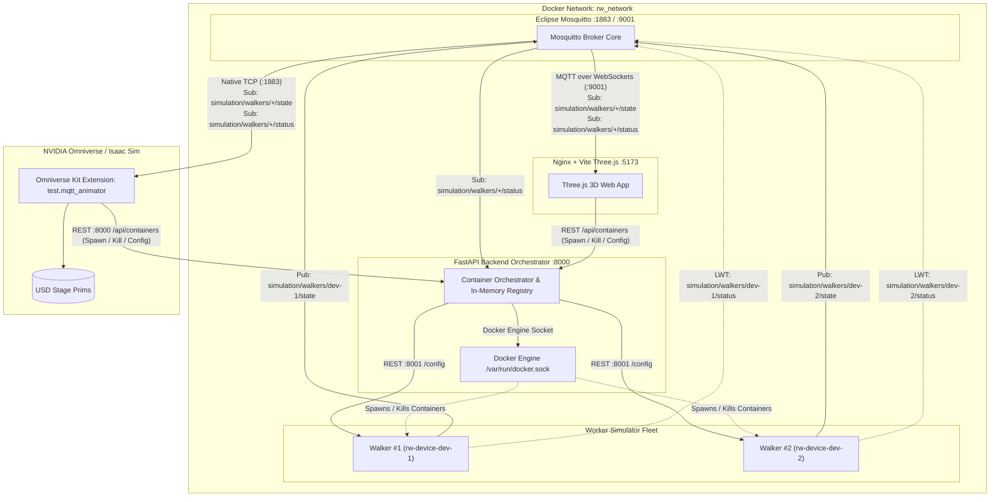

# Distributed 3D Random Walk Simulator (Multi-Topic MQTT + Docker Fleet + Three.js)

A distributed microservice architecture and benchmarking platform for **autonomous agents, IoT devices, and digital twin simulation backends** that publish telemetry in real time via **Eclipse Mosquitto MQTT** to a **Three.js 3D web client** (and future **NVIDIA Omniverse** connector).

The system decouples device simulation, message transport, container orchestration, and 3D visualization. From the web UI, you can dynamically **spawn, monitor, reconfigure, and terminate** individual device containers on the fly.

---

## 🏗️ System Architecture



### Components:
1. **MQTT Message Broker (`rw-mqtt`)**:
   - Eclipse Mosquitto 2 listening on port `1883` (raw TCP for workers, backend, Omniverse) and port `9001` (WebSockets for Three.js).
   - Serves as the central multiplexing event bus with sub-millisecond push latency.
2. **Frontend (`rw-frontend`)**:
   - Nginx-backed Three.js WebGL application running on port `5173`.
   - Connects directly to Mosquitto via `mqtt.js` on port `9001`, subscribing to multi-topics.
   - Multi-device 3D rendering with distinct colors, trailing paths, and color-matched target waypoints.
   - Left Panel: **Container Fleet Orchestrator** with scrollable device list, per-device controls, and spawn modal.
   - Right Panel: **Global HUD** with global interpolation algorithm selector (`v1`–`v5`), pipeline delay breakdown, and buffer horizon controls.
3. **NVIDIA Omniverse Extension (`test.mqtt_animator`)**:
   - Native Kit extension running in Omniverse / Isaac Sim with full feature parity with the web client.
   - Connects to Mosquitto via TCP port `1883`, updating dynamic USD Stage prims (`/World/Walkers/{id}`).
   - Centripetal Catmull-Rom smoothing with virtual endpoint reflection and low-frequency (1 Hz) smoothness.
   - Built-in `omni.ui` window for live fleet telemetry, algorithm switching, and container lifecycle control.
4. **Container Orchestrator & Gateway (`rw-collector`)**:
   - FastAPI server running on port `8000` mounted to `/var/run/docker.sock`.
   - Manages the lifecycle of device simulator containers (`spawn`, `kill`, `list`).
   - Proxies real-time configuration changes to running device containers via their internal HTTP control port (`8001`).
   - Tracks active fleet presence in-memory via MQTT status subscriptions.
4. **Autonomous Device Simulators (`rw-device-<id>`)**:
   - Lightweight containerized Python workers built from `random-walk-device:latest`.
   - Run continuous physics calculations at 60 Hz.
   - Publish real-time coordinates to `simulation/walkers/{device_id}/state` at their configured frequency (`write_hz`).
   - Register an **MQTT Last Will and Testament (LWT)** on `simulation/walkers/{device_id}/status` to immediately signal unexpected crashes or disconnects.
   - Expose internal REST control port (`8001`) for live configuration updates.

---

## 📡 MQTT Topic Schema

| Topic | Publisher | QoS | Retained | Description |
| :--- | :--- | :---: | :---: | :--- |
| `simulation/walkers/{id}/state` | Walker Container | `0` | No | Real-time position (`x`, `z`, `orientation`, `target_x`, `target_z`, `timestamp`). |
| `simulation/walkers/{id}/status` | Walker / Broker LWT | `1` | Yes | Connection status (`online` / `offline`) and metadata (`color`, `model_type`, `write_hz`). |

---

## ✨ Features & Controls

### Global Settings (Applied to All Walkers)
- **Frontend Smoothing Algorithm**:
  - **`v5: Centripetal Catmull-Rom`** (Recommended): 2-keyframe history window for continuous, fluid curvature without stutter or loops.
  - **`v4: Continuous Extrapolation`**: Zero-gap dead-reckoning for lowest visual latency.
  - **`v3: Hermite Spline`**: Filtered unique keyframe interpolation.
  - **`v2: Simple Exp LERP`**: Exponential moving average.
  - **`v1: Raw 0-Lag Snap`**: Unfiltered instantaneous state snapping.
  - *Detailed Analysis*: See [LATENCY_TRADEOFFS_AND_OPTIMIZATION.md](file:///home/km/agy2-projects/random_walk_mqtt_ov/LATENCY_TRADEOFFS_AND_OPTIMIZATION.md) and [INTERPOLATION_BENCHMARK.md](file:///home/km/agy2-projects/random_walk_mqtt_ov/INTERPOLATION_BENCHMARK.md) for full kinematic trade-off matrices and benchmark evaluations.
- **Target Buffer Delay Offset**: Adjustable slider (0 to 200 ms) with quick presets (0ms, 20ms, 40ms, 100ms).
- **Trailing Paths**: Global toggle to display or hide motion history trails.

### Individual Container Settings (Per Device)
- **Color Setter**: Native color picker + quick swatches. Waypoint beacon beam and pulse automatically match the walker's color.
- **Random Walk Model**:
  - **`Target Waypoints`**: Smooth vehicle kinematics steering towards randomized waypoints with turn rate damping.
  - **`Edge-Repulsion Cruise`**: Linear cruise with soft quadratic repulsion from arena boundaries.
  - **`Langevin Brownian`**: Physically-damped Brownian motion with gaussian acceleration noise.
- **Publish Frequency**: Dedicated slider per device (1 to 60 Hz).
- **Camera Focus**: Center and track the 3D OrbitControls camera on any selected walker.
- **Container Kill**: Instantly terminate and remove worker container with immediate MQTT offline broadcast.

---

## 🚀 Running the Stack

### Prerequisites
- [Docker](https://docs.docker.com/get-docker/) (v24+) & [Docker Compose](https://docs.docker.com/compose/) (v2+)
- Ensure your host user has Docker access:
  ```bash
  sudo usermod -aG docker $USER
  ```

### 1. Build and Start the Full Stack
Launch Mosquitto, backend orchestrator, frontend, and device base image in detached mode:
```bash
docker compose up -d
```
> The stack starts with **0 active devices** by design, allowing you to spawn devices on demand from the web UI.

### 2. Access the Application
Open your browser and navigate to:
**[http://localhost:5173](http://localhost:5173)**

- Click **"+ Spawn Device Container"** to launch one or more walkers.
- Each device will appear on the 3D canvas and in the scrollable left fleet panel.

### 3. Monitoring & Inspection
- Check container status:
  ```bash
  docker compose ps
  ```
- View all running containers (including dynamically spawned devices):
  ```bash
  docker ps --filter "name=rw-"
  ```
- View Mosquitto MQTT broker logs:
  ```bash
  docker compose logs -f mqtt
  ```
- View Backend Orchestrator logs:
  ```bash
  docker compose logs -f collector
  ```
- View a specific device container's logs:
  ```bash
  docker logs -f rw-device-<device_id>
  ```

---

## 🛑 Shutting Down the Stack

### 1. Automatic Graceful Shutdown (Recommended)
When you run `docker compose down`, the `rw-collector` service intercepts the shutdown signal and immediately terminates and removes all dynamically spawned worker containers (`rw-device-*`) concurrently via Docker SDK before the network is dismantled:
```bash
docker compose down
# or:
make down
```
All dynamic devices, static containers, and the `rw_network` bridge are removed cleanly without `Resource is still in use` errors.

### 2. Hard Reset / Emergency Clean
If the collector was previously forcefully killed (`SIGKILL`) or if stale containers from previous runs linger:
```bash
make clean
# or manually:
docker compose down -v --remove-orphans
docker rm -f $(docker ps -aq --filter name=rw-device-) 2>/dev/null || true
```

---

## 🪐 NVIDIA Omniverse & Isaac Sim Extension

The repository includes a production-ready NVIDIA Omniverse Kit extension in `extsUser/test.mqtt_animator` providing 3D simulation visualization and complete container fleet control directly inside Isaac Sim / USD Composer:

- **Sub-Millisecond MQTT Telemetry**: Background threaded subscriber connected to Mosquitto on `localhost:1883`, auto-discovering new devices and deregistering killed containers.
- **Dynamic USD Prims**: Automatically generates chassis prims at `/World/Walkers/{device_id}`, directional heading cones, waypoint beacon lasers, and continuous `UsdGeom.BasisCurves` motion trails with Y-up and Z-up stage detection.
- **Continuous Smoothing & Virtual Endpoint Reflection**: Implements Centripetal Catmull-Rom ($\alpha = 0.5$) with virtual endpoint reflection and starvation damping, maintaining fluid, non-jumping movement across all frequencies from **1 Hz to 60 Hz**.
- **Interactive Omniverse Window**: Built with `omni.ui` (**Window** > **MQTT Random Walk Animator**), featuring real-time connection telemetry, algorithm selector, buffer delay presets, spawn container modal, and live per-device control cards.

### Loading into Omniverse / Isaac Sim
Because the extension is symlinked into Isaac Sim's default `extsUser` folder:
```bash
/home/km/isaacsim_5.1/extsUser/test.mqtt_animator -> ./extsUser/test.mqtt_animator
```
1. Open **NVIDIA Omniverse / Isaac Sim**.
2. Go to **Window** > **Extensions**.
3. Search for `mqtt_animator` (or `MQTT 3D Random Walk Animator & Fleet Manager`).
4. Toggle the extension **ON**. The control panel opens immediately.

---

## 📁 Repository Structure

```text
random_walk_mqtt_ov/
├── docker-compose.yml       # Docker Compose topology (mqtt, collector, frontend, device-base)
├── mosquitto.conf           # Mosquitto MQTT configuration (TCP 1883 & WebSockets 9001)
├── backend/                 # Container Orchestrator & In-Memory Registry Service
│   ├── main.py              # FastAPI server, Docker SDK orchestration, MQTT subscriber
│   ├── Dockerfile           # Python 3.11 slim container definition
│   └── requirements.txt     # Dependencies (fastapi, uvicorn, paho-mqtt, docker, httpx)
├── device/                  # Autonomous Device Simulator Service (Dynamically Spawned)
│   ├── main.py              # 60Hz Physics engine, MQTT publisher, LWT, and HTTP control API (:8001)
│   ├── Dockerfile           # Python 3.11 slim container (tagged random-walk-device:latest)
│   └── requirements.txt     # Dependencies (fastapi, uvicorn, paho-mqtt, pydantic)
├── frontend/                # Three.js 3D Web Application
│   ├── index.html           # HTML layout with fleet panel, HUD, and spawn modal
│   ├── vite.config.js       # Vite bundler and dev server configuration
│   ├── Dockerfile           # Multi-stage build + Nginx container with /mqtt WebSocket proxy
│   ├── package.json         # Dependencies (three, mqtt, vite)
│   └── src/
│       ├── main.js          # Three.js scene, MQTT client (:9001), fleet cards & API bindings
│       ├── interpolation.js # Implementations of v1 through v5 interpolation modes
│       └── style.css        # Glassmorphism design, scrollable fleet list, and color swatches
├── extsUser/                # NVIDIA Omniverse Kit Extensions
│   └── test.mqtt_animator/  # Omniverse MQTT Animator & Fleet Controller Extension
│       ├── config/          # extension.toml with kit dependencies & pipapi
│       ├── test/            # Python extension package (Extension, StageManager, Interpolator, UIBuilder)
│       └── docs/            # Extension usage guides and changelog
├── INTERPOLATION_BENCHMARK.md # Empirical benchmark matrix and interpolation evaluation
├── LATENCY_TRADEOFFS_AND_OPTIMIZATION.md # Kinematic trade-offs & transport latency optimizations (QUIC, TCP_NODELAY, binary)
├── ROADMAP.md               # System roadmap for distributed scaling, resilience & Omniverse
└── README.md                # Project documentation
```

---

## 📜 License
Open-source under MIT License.