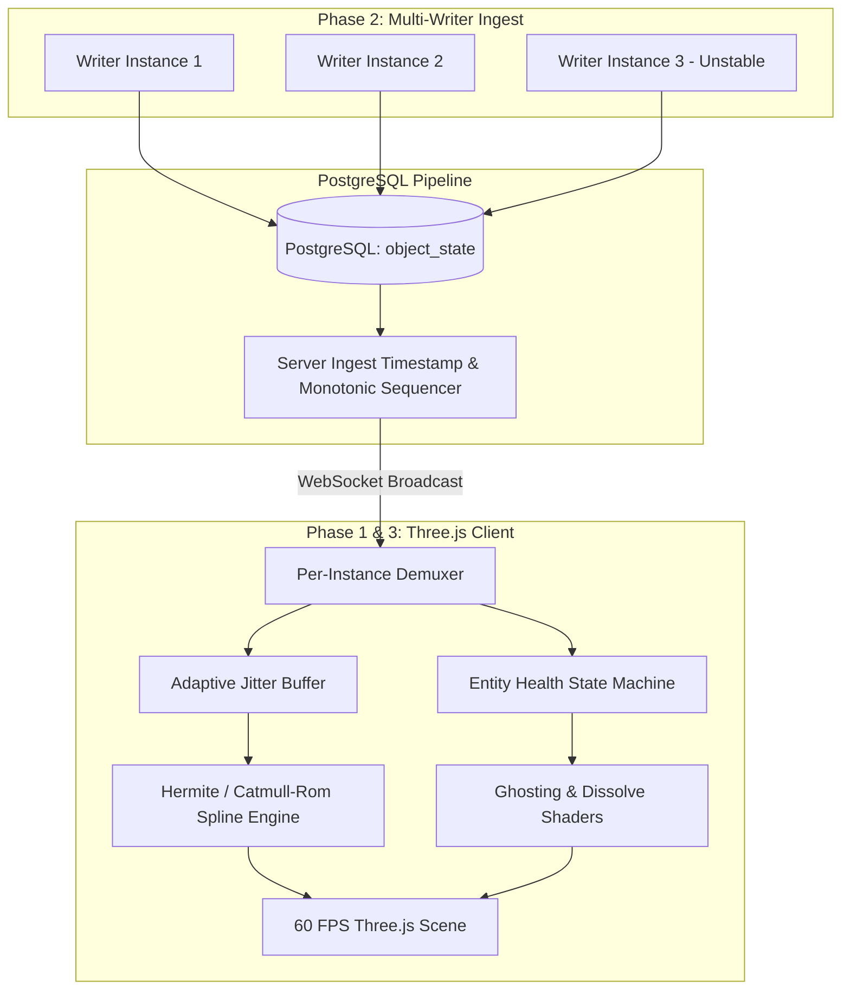

# 🗺️ System Roadmap: Resilient IoT & Multi-Instance 3D Telemetry

This document outlines the architectural roadmap for evolving `random_walk_mqtt_ov` from a single-entity simulation prototype into a production-ready, fault-tolerant 3D visualizer. The goal is to maintain smooth **60 FPS Three.js rendering** under real-world backend conditions, such as **random network jitter, multi-instance clock drift, and dropped connections**.

---

## 🏗️ Architectural Evolution Overview



---

## 📍 Phase 1: Adaptive Jitter Buffering & Dynamic Extrapolation (Latency & Gap Resilience)

**Primary Objective**: Eliminate stuttering, micro-freezes, and sudden snapping caused by irregular DB write frequencies, network jitter, or temporary data gaps.

### 1.1 Adaptive Dynamic Playback Jitter Buffer (`v6` Engine)
- **Sliding Window Queue**: Store incoming keyframes per entity: `[(x, y, z, rotation, t_server)]`.
- **Dynamic Delay Calibration**: Render at a dynamic delayed offset:
  $$t_{\text{render}} = t_{\text{client}} - D_{\text{adaptive}}$$
- **Jitter Tracking**: Compute standard deviation of frame arrival variance ($\sigma_{\text{jitter}}$) over a sliding 30-packet window. Dynamically expand $D_{\text{adaptive}}$ during high network/DB latency variance and contract during stable periods to minimize latency.

### 1.2 Timestamp-Normalized Splines
- Refactor interpolation logic (`v5` Catmull-Rom & Hermite) to parameterize time using exact server timestamps rather than fixed frame ticks:
  $$u = \frac{t_{\text{render}} - t_k}{t_{k+1} - t_k}$$
- Ensures continuous velocity ($\vec{v}$) and acceleration ($\vec{a}$) across variable duration gaps ($t_{k+1} - t_k$).

### 1.3 Dead Reckoning with Ease-Out Friction
- **Buffer Starvation Fallback**: If the telemetry queue starves ($t_{\text{render}} > t_{\text{latest}}$), extrapolate along the last known velocity vector $\vec{v}$ and angular velocity $\omega$.
- **Exponential Velocity Decay**: Apply friction decay:
  $$\vec{v}_{t+\Delta t} = \vec{v}_t \cdot (0.92)^{\Delta t}$$
- Objects glide gracefully to a natural stop instead of freezing abruptly mid-frame or flying off-screen.

---

## 📍 Phase 2: Multi-Instance Pipeline & Timestamp Normalization (Multi-Writer Support)

**Primary Objective**: Support dozens of independent autonomous agents writing to PostgreSQL concurrently without keyframe collision, out-of-order sequence issues, or clock drift distortion.

### 2.1 Database Schema & Monotonic Sequencer
- Upgrade PostgreSQL schema to accommodate multiple instances and reliable server-side ordering:
  ```sql
  CREATE TABLE object_state (
      instance_id VARCHAR(64) NOT NULL,
      seq_id BIGSERIAL,
      device_timestamp TIMESTAMPTZ NOT NULL,
      received_at TIMESTAMPTZ DEFAULT CURRENT_TIMESTAMP,
      x DOUBLE PRECISION NOT NULL,
      z DOUBLE PRECISION NOT NULL,
      orientation DOUBLE PRECISION NOT NULL,
      PRIMARY KEY (instance_id, seq_id)
  );
  CREATE INDEX idx_instance_rec ON object_state (instance_id, received_at DESC);
  ```

### 2.2 Client-Side Per-Instance Demuxing
- Implement a demultiplexer in the frontend WebSocket layer to split incoming packets into isolated per-entity timeline queues (`EntityStateEngine[instance_id]`).
- Prevent interpolation bleeding or state corruption between distinct 3D models.

### 2.3 Timeline Normalization & Clock Drift Calibration
- **Ingress Server Reference**: Use `received_at` / `seq_id` as the authoritative sequence timeline.
- **Client Clock Offset Normalization**: Perform periodic lightweight RTT ping-pong probes between frontend client and backend server to estimate client-server clock offset:
  $$\text{offset} = t_{\text{server}} - \left(t_{\text{client}} + \frac{\text{RTT}}{2}\right)$$

---

## 📍 Phase 3: Entity Lifecycle State Machine & Exception Handling (Fault Tolerance)

**Primary Objective**: Provide clear visual diagnostics and smooth UX transitions when entities lose connectivity, crash, or reconnect after a long offline period.

### 3.1 4-Stage Entity Health State Machine

| Health State | Trigger Condition | 3D Rendering & Kinematic Behavior |
| :--- | :--- | :--- |
| **`ACTIVE`** | Telemetry flowing normally ($\le 1.5 \times \Delta t_{\text{expected}}$) | Full opacity, continuous smooth spline interpolation. |
| **`STALE`** | Telemetry delayed ($> 1.5 \times \Delta t_{\text{expected}}$) | Ease-out dead-reckoning extrapolation; amber HUD warning badge. |
| **`DISCONNECTED`**| No update for $> 3.0\text{ seconds}$ | Entity brought to full stop; switch to **Hologram Wireframe Material**. |
| **`OFFLINE`** | No update for $> 10.0\text{ seconds}$ | Smooth 1-second opacity dissolve animation; unmount mesh from Three.js scene. |

### 3.2 Holographic Shader & Visual Status Diagnostics
- **Pulsing Ground Status Beacon**: Color-coded 3D rings under each entity (Green = Healthy, Yellow = Delayed/Jittering, Red = Connection Lost).
- **Hologram / Wireframe Dissolve Shader**: Custom Three.js shader for `DISCONNECTED` entities to communicate that location data is currently unverified.

### 3.3 Reconnection Warp & Smooth Relocation
- Prevent snapping teleports when an offline entity reconnects at a distant coordinate.
- Offer configurable re-entry transitions:
  - **Trail Dash Interpolation**: Rapid linear glide with particle trail.
  - **Spawn Pulse**: Particle fade-in effect at the newly updated coordinate.

---

## 📍 Phase 4: Chaos Engineering, Diagnostics UI & Benchmark Suite

**Primary Objective**: Provide interactive developer tools in the HUD to simulate bad network conditions and stress-test visualization resilience.

### 4.1 HUD Chaos Control Panel
- **Packet Loss Injector**: Slider to randomly drop 0%–50% of backend DB poll frames.
- **Latency Jitter Generator**: Inject Gaussian random delay (0–2000 ms) per packet.
- **Multi-Instance Spawner**: Button to spawn 5, 20, or 100 simultaneous simulated random walk instances.
- **Instance Connection Kill Switch**: Toggle to instantly freeze DB updates for a selected instance to test fallback logic.

### 4.2 HUD Telemetry & Health Dashboard
- Real-time per-instance statistics:
  - Active Jitter Buffer depth (ms).
  - Out-of-order packet count.
  - Packet drop percentage.
  - State machine status indicators (`ACTIVE`, `STALE`, `DISCONNECTED`, `OFFLINE`).

---

## 📊 Milestone Summary Table

| Milestone | Target Feature | Core Tech / Component | Expected Outcome |
| :--- | :--- | :--- | :--- |
| **Phase 1** | Adaptive Jitter Buffer & Friction Extrapolation | Three.js + `interpolation.js` (`v6`) | Zero micro-stuttering under 0-2s variable DB gaps |
| **Phase 2** | Multi-Instance Demux & Sequencer | PostgreSQL `seq_id` + FastAPI Demuxer | Scalable visualization of 50+ concurrent instances |
| **Phase 3** | Entity Lifecycle & Holographic FX | Three.js Custom Shader + State Machine | Smooth handling of crashes & disconnections |
| **Phase 4** | HUD Chaos Injector & Stress Testing | Vite HUD Panel + Synthetic Chaos Engine | Verification under simulated 50% packet loss & jitter |
